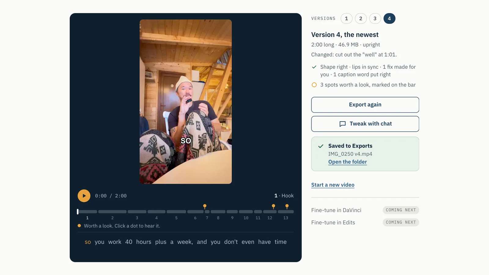
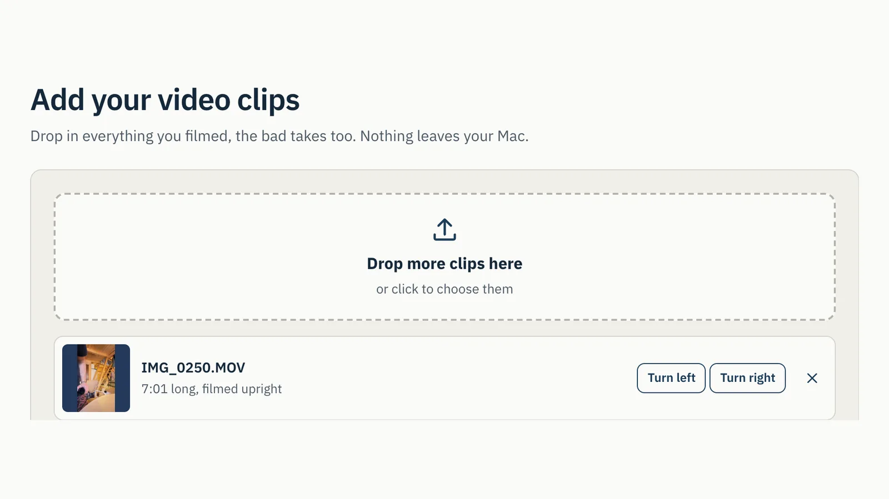
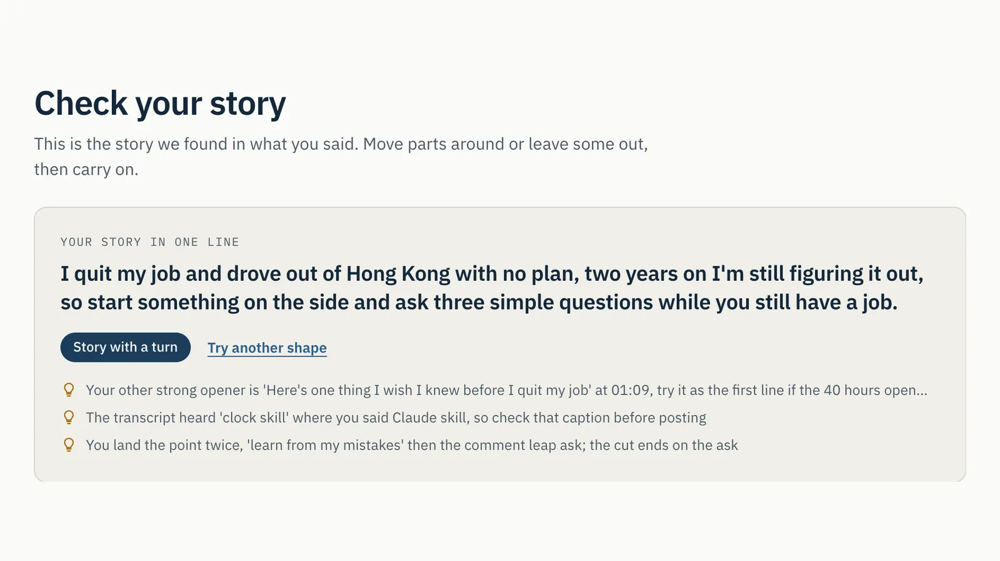
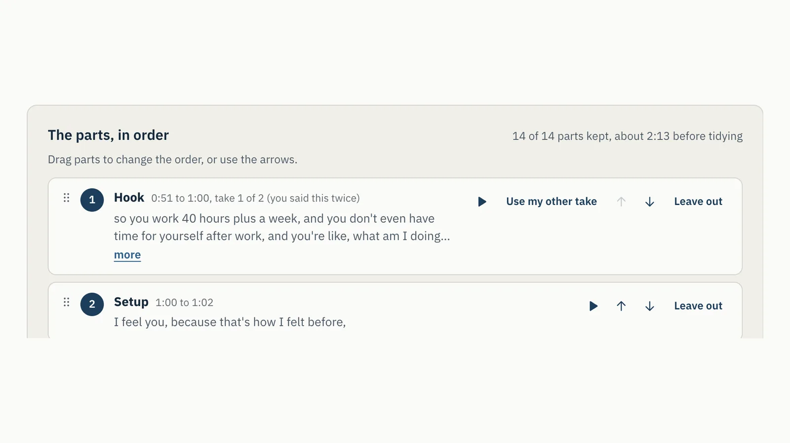

# Creator Pack Editor (beta)

**Drop in a raw talking video. It finds your story, puts your hook first and cuts the video around it.**

Talk to the camera in one long take or several. Creator Pack Editor listens to every word, works out the story you were trying to tell and builds the video in the order that tells it best. Free beta. A Claude Code plugin for Mac.



## What it does

- **Finds your story.** It reads everything you said and gives the story back to you in one line.
- **Finds your hook and puts it first.** The line that makes people stay goes at the top, wherever you said it.
- **Picks your best take.** Said something twice? It uses the better one. One click swaps to the other.
- **Reorders the parts.** What you said gets put in the order that tells a better story. Drag any part to change it.
- **Cuts the ums, pauses and retakes.** Every cut lands on a quiet gap, so no word gets clipped.
- **Keeps your lips in sync.** Checked on every clip before you see the video.
- **Adds captions of exactly what you said.** Word for word. Cantonese comes out in Traditional characters.
- **Changes anything by chat.** "Start with the line about quitting." "Drop the bit about the weather." You get a new version and the old ones stay.

Everything runs on your Mac and your footage never leaves it. The cutting uses nothing from your Claude plan. Only finding the story and the chat use Claude.

## How it works

**1. Drop your video.** Everything you filmed, the bad takes too.



**2. Check your story.** Your story in one line, plus notes like a stronger opener it found at 01:09.



**3. Your hook, then the parts.** Each part shows its take. Move it, swap to your other take or leave it out.



**4. Get your video.** Captions on, every cut checked. Export it or ask the chat for changes.

## Install

1. Open Claude Code (in the Claude desktop app, the **Code** tab).
2. Paste this and press Enter.

   ```
   Install the Creator Pack Editor plugin for me: run claude plugin marketplace add breakingcyclesexe-debug/creator-pack and then claude plugin install creator-pack@creator-pack
   ```

3. When it says it's installed, type `/reload-plugins`, then `/creator-pack`. A page opens in your browser. Drop your video.

**First time only.** The page checks your Mac and installs what's missing with one click. About 10 minutes, most of it the speech model download.

**You need** a Mac with an Apple chip (M1 or newer) and Claude Pro or Max.

**Updates.** Type `/plugin marketplace update creator-pack`, then `/reload-plugins`. Your videos stay put.

**If the install line doesn't work,** download the zip from the [Releases page](https://github.com/breakingcyclesexe-debug/creator-pack/releases), unzip it somewhere you'll keep it and start Claude Code with `claude --plugin-dir ~/Documents/creator-pack-<version>`.

## Coming in the next update

- Caption looks (Soft, Clean, Glow)
- Caption placement
- Pop-in caption motion

## Coming after that

- Motion graphics, punch-in zooms and titles
- Fine-tune in DaVinci Resolve or Instagram Edits
- Story Studio, for ideas, story options and a script before you film

## How long it takes

| Step | Time |
|---|---|
| Setup, once | About 10 minutes |
| Story, after you press Go | About a minute for a few minutes of footage |
| The cut | About 2 minutes for a short video |

## Where your files go

Everything is in `Movies/Creator Pack`, one folder per video with **Footage**, **References** and **Exports**. **Open folder** on the page shows it in Finder. Removing the plugin never deletes your videos.

## When something goes wrong

**The page says "Claude isn't listening".** Claude Code was closed. Open it and type `/creator-pack`. It picks up where you left off.

**Setup says something is missing.** Press **Check again** after an install finishes. If one keeps failing, the page shows why under it. Homebrew is the one install you do yourself, by pasting the line the page shows into Terminal.

**The page won't open.** In Claude Code, ask "open the creator pack page". It lives on your Mac only, at an address starting `http://127.0.0.1`.

## Beta limits

- Mac with an Apple chip only. Windows comes later.
- English works best. Cantonese and Mandarin captions are early.

## Feedback

Tell us what confused you, what broke and what you wished it did. Open an issue on this repo or DM us on Instagram. A screen recording or the video's name helps a lot.
